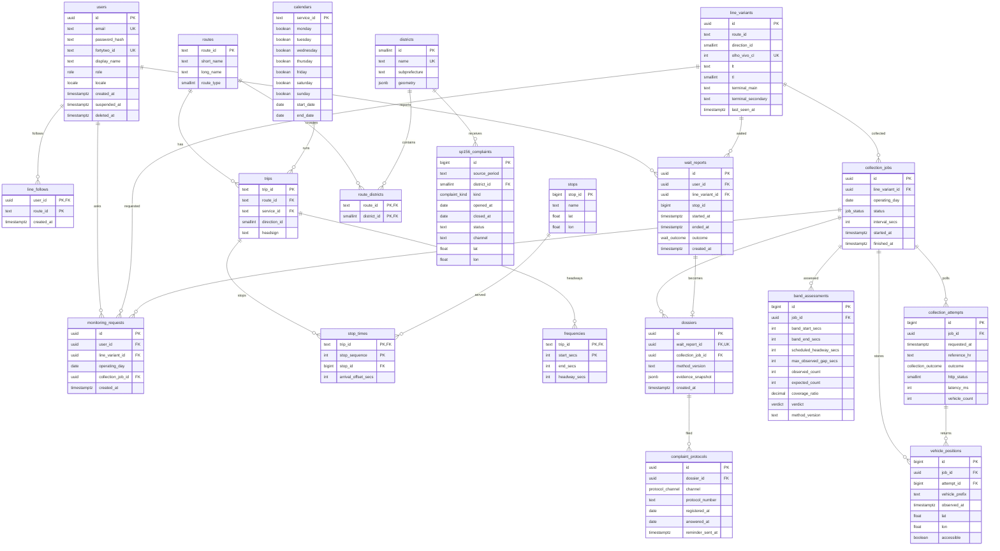

_This project has been created as part of the 42 curriculum by jucoelho, galves-a, eduribei, vinda-si, dajesus._

# Observatório

## Description

Observatório is a citizen observatory for São Paulo buses. It collects vehicle positions from the SPTrans Olho Vivo API, compares them with the official GTFS schedule, and turns a passenger's wait into a report they can use in a 156 complaint or a public information request (LAI).

Observations, estimates and data gaps are always kept apart: a bus missing from the API is never reported as a trip that did not happen.

## Instructions

### Prerequisites

- Docker with Docker Compose v2
- For local development: Node.js 22 and pnpm 10 (`corepack enable`)

### Run with Docker

```bash
cp .env.example .env
docker compose up --build
```

Open https://localhost:8443. The certificate is self-signed and generated on first start, so the browser asks you to accept it once.

### Local development

```bash
pnpm install
pnpm dev
```

| Command          | What it does                                 |
| ---------------- | -------------------------------------------- |
| `pnpm build`     | Builds every app and package with Turborepo  |
| `pnpm lint`      | Runs ESLint in every workspace               |
| `pnpm typecheck` | Type-checks every workspace                  |
| `pnpm test`      | Runs the test suites                         |
| `pnpm format`    | Formats the repository with Prettier         |
| `pnpm knip`      | Lists unused files, exports and dependencies |

### Repository layout

| Path               | Contents                                               |
| ------------------ | ------------------------------------------------------ |
| `apps/web`         | Next.js frontend with server-side rendering            |
| `apps/api`         | NestJS API                                             |
| `apps/collector`   | NestJS worker that collects Olho Vivo data             |
| `packages/core`    | Pure TypeScript domain shared by the api and collector |
| `packages/schemas` | Zod schemas shared by frontend and backend validation  |
| `packages/ui`      | Design system                                          |
| `packages/config`  | Shared TypeScript and ESLint configuration             |
| `infra/nginx`      | Reverse proxy that terminates HTTPS                    |

## Team Information

| Member   | Login      | Roles                                   |
| -------- | ---------- | --------------------------------------- |
| Eduardo  | `eduribei` | Product Owner, Developer                |
| Júlia    | `jucoelho` | Project Manager, Developer              |
| Daniel   | `dajesus`  | Project Manager (to confirm), Developer |
| Gyasmin  | `galves-a` | Technical Lead / Architect, Developer   |
| Vinícius | `vinda-si` | Developer                               |

## Project Management

To be completed: task distribution, meetings, tools and communication channels.

## Technical Stack

| Layer    | Technology                                                   |
| -------- | ------------------------------------------------------------ |
| Frontend | Next.js 16, React 19, Tailwind CSS 4                         |
| Backend  | NestJS 12                                                    |
| Database | PostgreSQL 17                                                |
| Tooling  | pnpm workspaces, Turborepo, TypeScript 6, ESLint 9, Prettier |
| Runtime  | Docker Compose, nginx (TLS)                                  |

## Database Schema

PostgreSQL 17, managed with Prisma. The source of truth is [`packages/database/prisma/schema.prisma`](packages/database/prisma/schema.prisma) and the migrations next to it. The 20 tables fall into six groups:

| Group         | Tables                                                                                                | Filled by                         |
| ------------- | ----------------------------------------------------------------------------------------------------- | --------------------------------- |
| Accounts      | `users`, `line_follows`                                                                               | Sign-up and line follows          |
| GTFS schedule | `routes`, `calendars`, `trips`, `stops`, `stop_times`, `frequencies`                                  | GTFS import                       |
| Collection    | `line_variants`, `monitoring_requests`, `collection_jobs`, `collection_attempts`, `vehicle_positions` | Collector, from the Olho Vivo API |
| Assessment    | `band_assessments`                                                                                    | Comparison with the schedule      |
| Reports       | `wait_reports`, `dossiers`, `complaint_protocols`                                                     | Passengers                        |
| Open data     | `districts`, `sp156_complaints`, `route_districts`                                                    | SP156 and district imports        |



`line_follows.route_id`, `line_variants.route_id` and `wait_reports.stop_id` hold GTFS identifiers without a foreign key.

## Features List

To be completed as features are implemented.

## Modules

To be completed with the chosen modules, points and justifications.

## Individual Contributions

To be completed by each team member.

## Resources

- [SPTrans Olho Vivo API](https://www.sptrans.com.br/desenvolvedores/api-do-olho-vivo-guia-de-referencia/)
- [GTFS Schedule Reference](https://gtfs.org/documentation/schedule/reference/)
- [Next.js documentation](https://nextjs.org/docs)
- [NestJS documentation](https://docs.nestjs.com)
- [Turborepo documentation](https://turborepo.com/docs)

### Use of AI

AI was used to scaffold the monorepo (workspace, tooling, Docker and nginx configuration) and to draft the architecture documentation. Every generated file was reviewed by the team.
